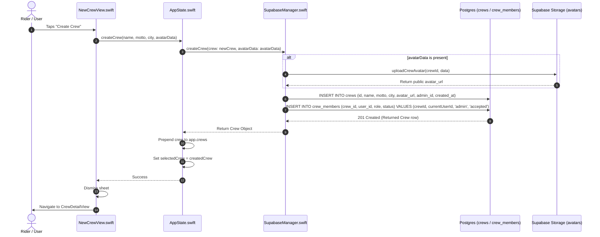

# CREW USER FLOW & MEMBERSHIP LIFECYCLE AUDIT

**Convoy iOS Application Architecture Audit**  
**Document:** `docs/product/CREW_USER_FLOW.md`  
**Platform:** Native iOS / SwiftUI / Supabase / SwiftData  
**Inspection Date:** November 2026  

---

## 1. Executive Summary & Flow Overview

In Convoy, a **Crew** represents a persistent social riding club or group of riders who frequently ride together. The Crew feature is accessible directly as the third root tab (`.crew`) in the main navigation shell ([`MainTabs.swift`](file:///Users/user52/Desktop/Convoy-Main/Convoy/MainTabs.swift#L37)).

The Crew lifecycle spans four primary phases:
1. **Empty State & Discovery:** Viewing current crew memberships or navigating the empty state CTA.
2. **Crew Creation:** Defining crew identity (Name, Tag/Motto, Home City, and Avatar photo).
3. **Member Invitation:** Searching platform users by handle/name and dispatching membership invitations.
4. **Crew Management & Membership Governance:** Viewing the member roster, role badges (Admin vs. Member), and participating in crew rides.

This audit documents the end-to-end screen transitions, underlying data operations in `AppState.swift` and `SupabaseManager.swift`, persistence guarantees, and critical functional gaps currently present in the implementation.

---

## 2. Screen-by-Screen User Journey Walkthrough

### 2.1 Screen: Crew Home Hub ([`CrewView.swift`](file:///Users/user52/Desktop/Convoy-Main/Convoy/CrewView.swift#L10))

#### UI & Presentation
- **Header:** "YOUR CREW" with a glassmorphism pill badge showing total active crews.
- **Top Actions:**
  - `"+" (New Crew Button)`: Positioned at top-trailing, triggers `.sheet(isPresented: $showNewCrew)` presenting [`NewCrewView`](file:///Users/user52/Desktop/Convoy-Main/Convoy/NewCrewView.swift).
- **Primary Content Views:**
  - **Empty State (`EmptyCrewView`):** Rendered if `app.crews.isEmpty`. Shows helmet/crew graphic, descriptive copy ("No crew yet. Form your riding club, plan trips together, and stay connected on the road."), and a primary CTA "Create a Crew".
  - **Populated State:** A vertical scroll view rendering two sections:
    1. **Active Crews Carousel/List:** Cards displaying Crew Avatar, Crew Name, Motto, Member Count, and Admin Crown indicator if `crew.adminId == app.currentUser.id`. Tapping a card executes `app.selectedCrew = crew` and pushes [`CrewDetailView`](file:///Users/user52/Desktop/Convoy-Main/Convoy/CrewDetailView.swift).
    2. **Pending Crew Invitations (`PendingCrewInvitesCard`):** If the user has incoming invitations in `app.pendingCrewInvites`, cards display the inviter's handle, crew name, and inline "Accept" and "Decline" action buttons.

#### Technical Execution & State
- On view appearance (`.task`), `CrewView` triggers `await app.fetchCrews()` and `await app.fetchPendingCrewInvites()`.
- Data Source: Reactive bindings to `@EnvironmentObject var app: AppState`.

---

### 2.2 Screen: Crew Creation ([`NewCrewView.swift`](file:///Users/user52/Desktop/Convoy-Main/Convoy/NewCrewView.swift#L12))

#### User Actions & Field Validation
- **Avatar Selection:** Tapping the circular photo picker triggers iOS `PhotosPicker(selection: $selectedPhotoItem, matching: .images)`.
  - When an image is picked, it loads as `UIImage`, compresses to JPEG data, and sets `@State private var avatarData: Data?`.
- **Form Input Fields:**
  1. `Crew Name` (Required): Text field with character limit and auto-capitalization. Placeholder: e.g., "Thunderbolts MC".
  2. `Tag / Motto` (Optional): Text field. Placeholder: e.g., "Ride or Die".
  3. `Home City` (Optional): Text field. Placeholder: e.g., "Bengaluru, KA".
- **Validation Rule:** The primary CTA button "Create Crew" is disabled unless `!crewName.trimmingCharacters(in: .whitespacesAndNewlines).isEmpty`.
- **Submission Action:** Tapping "Create Crew" executes `Task { await createCrew() }`.

#### Backend Data Flow for Creation


- **Underlying File References:**
  - UI Handler: [`NewCrewView.swift:142-178`](file:///Users/user52/Desktop/Convoy-Main/Convoy/NewCrewView.swift#L142-L178)
  - Business Logic: [`AppState.swift:1085-1120`](file:///Users/user52/Desktop/Convoy-Main/Convoy/AppState.swift#L1085-L1120)
  - Supabase Mutation: [`SupabaseManager.swift:740-795`](file:///Users/user52/Desktop/Convoy-Main/Convoy/SupabaseManager.swift#L740-L795)

---

### 2.3 Screen: Crew Detail View ([`CrewDetailView.swift`](file:///Users/user52/Desktop/Convoy-Main/Convoy/CrewDetailView.swift#L15))

#### Header & Visual Identity
- Dynamic dark glass header displaying the crew avatar (cached or fetched via `AsyncImage`), crew title, motto, and city badge.
- Stats strip:
  - Total Members (Count)
  - Total Completed Rides
  - Total Kilometers Covered

#### Action Hub
- **"Plan Ride with Crew":** Secondary button. Automatically seeds `app.selectedCrew = currentCrew` and triggers the Trip Planning workflow (`app.activePlanStep = .who` or directly enters `PlanDetailsView`).
- **"Invite Riders":** Only visible if the current user is an Admin (`crew.adminId == app.currentUser.id`). Opens [`CrewInviteView`](file:///Users/user52/Desktop/Convoy-Main/Convoy/CrewInviteViews.swift).
- **Crew Members Roster:**
  - Displays each member with avatar, display name, handle (`@username`), and role badge ("ADMIN" in orange glass or "MEMBER" in muted silver).

---

### 2.4 Screen: Member Search & Invitation ([`CrewInviteViews.swift`](file:///Users/user52/Desktop/Convoy-Main/Convoy/CrewInviteViews.swift#L14))

#### Search & Selection Mechanics
1. **Search Input:** A text bar bound to `@State private var query: String = ""`.
2. **User Search Query:**
   - As the user types (debounced 300ms), executes `app.searchRiders(query: query)`.
   - Hits Supabase query:
     ```sql
     SELECT id, full_name, username, avatar_url 
     FROM profiles 
     WHERE username ILIKE :query OR full_name ILIKE :query 
     LIMIT 20;
     ```
3. **Exclusion Logic:** Users already in `crew.members` or already invited (`status == .pending`) are marked with an inactive badge "Already In Crew" or "Invited".
4. **Multi-Selection:** Admin taps multiple users; selected users appear in a horizontal pill carousel at the top with "X" delete tags.
5. **Dispatch CTA:** "Send (N) Invites".

#### Invitation Persistence Sequence
- Tapping "Send Invites" calls `app.inviteUsersToCrew(crewId: crew.id, userIds: selectedUserIds)`.
- In `SupabaseManager.swift`:
  ```sql
  INSERT INTO crew_members (crew_id, user_id, role, status, invited_by)
  VALUES (:crewId, :userId, 'member', 'pending', :currentUserId);
  ```
- Creates corresponding notification records in the `notifications` table for each recipient (`type: 'crew_invite'`).

---

### 2.5 Screen: Receiving & Responding to Crew Invites

#### Invitee Perspective
1. **Discovery:** The recipient sees a red badge on the Crew tab and an alert card in `NotificationView.swift` and `CrewView.swift`.
2. **Card Information:** Shows Inviting Crew Name, Inviter Handle ("@rajesh invited you"), and Crew City.
3. **Actions:**
   - **Accept:** Calls `app.respondToCrewInvite(crewId: id, accept: true)`.
     - Updates `crew_members` row: `SET status = 'accepted', updated_at = NOW() WHERE crew_id = :id AND user_id = :currentUserId`.
     - App state re-fetches crews; the crew immediately appears in the recipient's Active Crews list.
   - **Decline:** Calls `app.respondToCrewInvite(crewId: id, accept: false)`.
     - Updates `crew_members` row: `SET status = 'declined'`.
     - Removes the invitation card from the UI.

---

## 3. Data Schema & Models

### Swift Model Definition (`Crew` and `CrewMember`)
Defined in [`Models.swift:340-395`](file:///Users/user52/Desktop/Convoy-Main/Convoy/Models.swift#L340-L395):

```swift
public struct Crew: Identifiable, Codable, Equatable, Sendable {
    public let id: String
    public var name: String
    public var motto: String?
    public var city: String?
    public var avatarURL: String?
    public var adminId: String
    public var memberCount: Int
    public var members: [CrewMember]
    public var createdAt: Date
}

public struct CrewMember: Identifiable, Codable, Equatable, Sendable {
    public let id: String
    public let userId: String
    public let displayName: String
    public let username: String
    public let avatarURL: String?
    public let role: CrewRole // .admin | .member
    public let status: CrewMemberStatus // .pending | .accepted | .declined
    public let joinedAt: Date?
}
```

### Underlying Supabase Tables
1. **`crews`**:
   - `id: uuid PRIMARY KEY`
   - `name: text NOT NULL`
   - `motto: text`
   - `city: text`
   - `avatar_url: text`
   - `admin_id: uuid REFERENCES profiles(id)`
   - `created_at: timestamptz DEFAULT now()`

2. **`crew_members`**:
   - `id: uuid PRIMARY KEY DEFAULT gen_random_uuid()`
   - `crew_id: uuid REFERENCES crews(id) ON DELETE CASCADE`
   - `user_id: uuid REFERENCES profiles(id) ON DELETE CASCADE`
   - `role: text CHECK (role IN ('admin', 'member'))`
   - `status: text CHECK (status IN ('pending', 'accepted', 'declined'))`
   - `invited_by: uuid REFERENCES profiles(id)`
   - `created_at: timestamptz DEFAULT now()`
   - `updated_at: timestamptz DEFAULT now()`
   - *Constraint:* `UNIQUE (crew_id, user_id)`

---

## 4. Architectural & Implementation Gaps in Crew Management

Through line-by-line inspection of [`CrewDetailView.swift`](file:///Users/user52/Desktop/Convoy-Main/Convoy/CrewDetailView.swift), [`CrewView.swift`](file:///Users/user52/Desktop/Convoy-Main/Convoy/CrewView.swift), and [`AppState.swift`](file:///Users/user52/Desktop/Convoy-Main/Convoy/AppState.swift), the following gaps are verified:

| Gap / Missing Feature | Location | Impact | Severity |
| :--- | :--- | :--- | :--- |
| **No Member Removal Flow** | `CrewDetailView.swift:180-220` | An admin cannot remove a member or revoke an invite once sent. No swipe-to-delete or context menu exists. | **High** |
| **No "Leave Crew" Option** | `CrewDetailView.swift:230-260` | A non-admin member has no UI or action to voluntarily leave a crew. | **High** |
| **No Crew Edit Capability** | `CrewDetailView.swift:50-80` | Once created, crew name, motto, city, and avatar cannot be edited by the admin. | **Medium** |
| **No Crew Deletion Option** | `CrewDetailView.swift` | An admin cannot disband or delete the crew. | **High** |
| **No Offline / Local Sync** | `AppState.swift:1085` | If a network error occurs while fetching or modifying crews, there is no SwiftData persistence fallback; UI displays an empty state. | **Medium** |
| **No Admin Transfer** | `CrewDetailView.swift` | If an admin leaves or wants to promote another rider to co-admin, no role-update API is exposed. | **Low** |

---

## 5. Summary Verdict

The Crew foundation functions smoothly for **Creation**, **Discovery**, and **Inviting Members via Username Search**. However, it is currently **unbalanced in governance**: once users join a crew, there is neither an exit mechanism for riders nor administrative controls for the crew creator. These operations require dedicated UI actions and Supabase delete/update policies to complete the full membership lifecycle.

