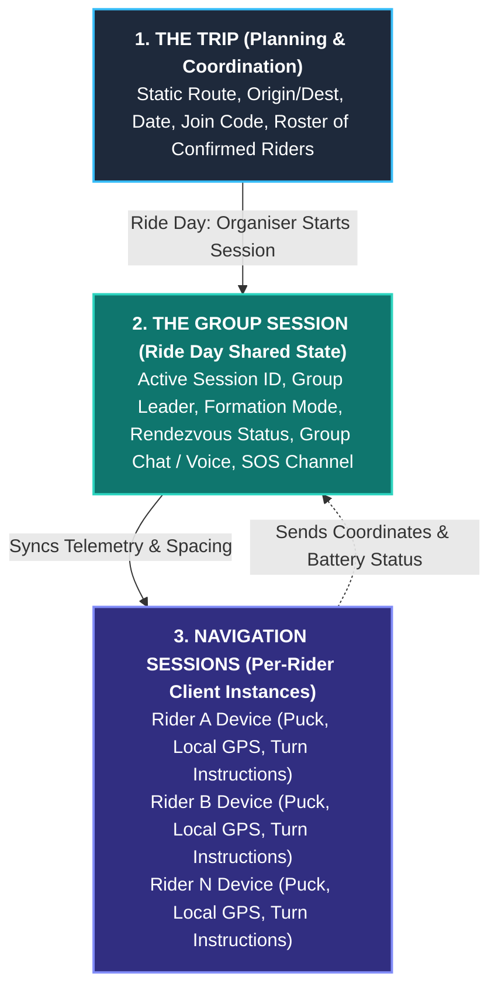
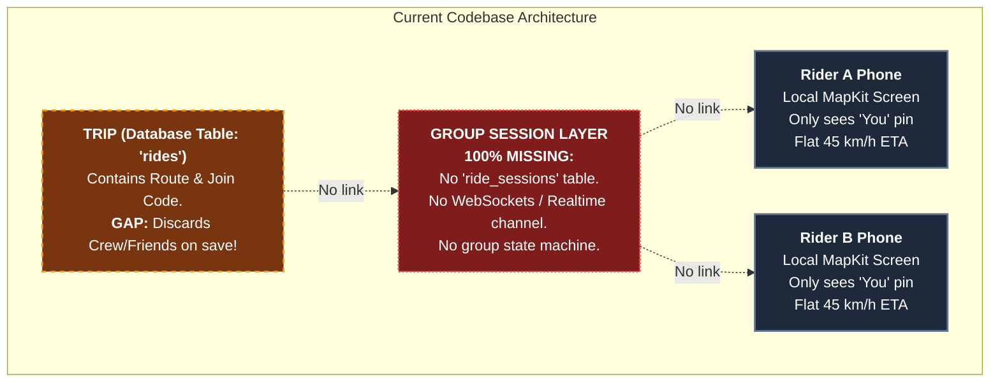

# IMPLEMENTATION GAP ANALYSIS: VISION VS. CURRENT CODEBASE

**Convoy iOS Application Architecture Audit**  
**Document:** `docs/product/IMPLEMENTATION_GAP_ANALYSIS.md`  
**Platform:** Native iOS / SwiftUI / Supabase / Realtime  
**Inspection Date:** November 2026  

---

## 1. The Core Vision: "One Trip ➔ One Group Session ➔ Many Navigation Sessions"

Convoy is conceived as a collaborative, real-time motorcycle group riding platform. The intended conceptual model of the platform is structured in three concentric tiers:

### Vision Expectations:
1. **Tier 1 (The Trip):** The social agreement. Riders join via code or crew invitation. Roster is finalized.
2. **Tier 2 (The Group Session):** On ride day, starting the ride instantiates a **shared realtime session**. The session coordinates peer presence, calculates group dispersion (lead to sweep distance), tracks fallen/separated riders, and manages collective stop requests.
3. **Tier 3 (Navigation Sessions):** Each rider's iPhone renders the 3D cockpit perspective, provides local turn-by-turn guidance, and broadcasts its high-frequency telemetry into Tier 2 while receiving the positions of all other riders.

---

## 2. Reality Check: The Current State of the Codebase

When auditing the actual codebase, Tier 2 is **completely nonexistent**, Tier 1 has a broken participant pipeline, and Tier 3 operates in total isolation:

---

## 3. Four-Tier Classification of Existing Functionality

### 3.1 Tier A: Production-Connected & Functional
These features are thoroughly implemented, connected to Supabase or native APIs, and verified operational:
- **Authentication & Profiles:** Sign up, sign in, session persistence, profile photo storage, rider motorcycle details.
- **Discover Route Caching & Visualization:** Multi-route Discover hub, elevation profiles, surface classification, curated Indian routes, Stage 6A calibrated ETA calculation, filter tabs.
- **Crew Foundation:** Crew creation, image upload to Supabase storage, member search by `@username`, invitation dispatch, invite accept/decline.
- **Join-by-Code System:** Cryptographic 6-character code generation, lookup by code, found ride preview card, join request dispatch, organizer notification card, and atomic Postgres RPC approval.
- **Basic Turn-by-Turn Maneuvers & Audio TTS:** MapKit camera tracking, route polyline rendering, and spoken instructions via `AVSpeechSynthesizer`.

### 3.2 Tier B: Partially Implemented / Bugged
These features have UI and partial logic, but fail under realistic usage:
- **Trip Planning:** High-fidelity multi-step wizard, but `AppState.finishPlan()` completely discards `selectedCrew` and `selectedFriends`, saving the trip as an isolated solo ride.
- **Route Handoff from Discover:** Successfully seeds ride details, but drops curated POIs (petrol pumps, viewpoints) during the handoff to custom planning.
- **POI Finder in Navigation:** Searches nearby petrol stations via `MKLocalSearch`, but only drops static pins on the map without recalculating detours or turn guidance.
- **Crew Governance:** Full roster view, but zero UI or backend endpoints for removing members, leaving a crew, or editing crew details.

### 3.3 Tier C: Mocked / Simulated
These features appear functional in the UI, but execute purely simulated logic with no real-world effect:
- **SOS Emergency Broadcast:** Displays a 3-second hold countdown and changes to `"SOS BROADCAST SENT"`, but transmits zero network packets, SMS, or alerts.
- **Navigation ETA Engine:** Uses a hardcoded flat speed of `45 km/h` (`remainingDistance / 45 km/h`) rather than dynamic routing or live motorcycle pacing profiles.
- **Ride Day Check:** Uses a simple boolean toggle `app.rideDay = true` rather than calendar time synchronization or live check-in geofences.

### 3.4 Tier D: Completely Missing
These essential capabilities do not exist in any file or migration:
- **Group Ride Real-Time Session:** No concept of a live session bridging multiple riders.
- **Peer Map Annotations:** No data model, subscription, or view component for rendering fellow riders on the navigation map.
- **Organizer Start Broadcast:** No notification or state mutation informing participants that the organizer has started riding.
- **Background Location Tracking:** Background mode is disabled; app freezes location tracking upon screen lock.
- **Formation / Spacing Alerts:** No telemetry engine calculating distance between lead rider and sweep rider.
- **In-App Direct Ride Invitations:** No friend picker to invite existing Convoy users to a trip directly.

---

## 4. Gap Matrix: Vision vs. Code

| Domain | Vision Requirement | Current Code Implementation | Implementation Gap |
| :--- | :--- | :--- | :--- |
| **Trip Participant Selection** | Select crew or friends; everyone is invited to the trip roster | `PlanWhoView` selects crew/friends; `finishPlan()` discards them; 1 rider saved | **100% Disconnected** |
| **Ride Invitation** | Direct in-app invites + Share link + 6-char code | Only 6-char code & external share link; zero in-app friend invite picker | **Partial (50%)** |
| **Ride Start Synchronization** | Organiser starts; all riders receive push/alert and enter synced lobby | Organiser starts local 3s countdown; zero backend calls; participants unaware | **100% Disconnected** |
| **Live Telemetry & Tracking** | All riders broadcast GPS coords; map renders all peer pucks with spacing | Zero peer markers; map only renders `Annotation("You")`; zero coords sent | **100% Missing** |
| **Navigation ETA** | Dynamic segment-aware motorcycle pacing profile | Flat hardcoded `45 km/h` calculation | **Broken / Mock** |
| **Screen Lock Navigation** | Continuous audio prompts and background GPS logging | `allowsBackgroundLocationUpdates = false`; app suspends on lock | **Broken** |
| **Emergency SOS** | High-priority group alert + emergency contact SMS with GPS coordinates | 3s countdown displaying "SENT" with zero network calls | **Fake / Dangerous** |

---

## 5. Architectural Verdict

Convoy is currently a **well-designed visual prototype with isolated functional silos**. The individual building blocks (Discover, Join Code, Turn-by-Turn Map, Crew Creation) exhibit high UI polish. 

However, because the **Group Session Layer** is missing, the application fails to deliver on its primary value proposition: **it does not allow riders to ride together**. Fixing this requires treating the live ride session as an authoritative real-time state machine in Supabase, rather than treating active navigation as an isolated single-device screen.

