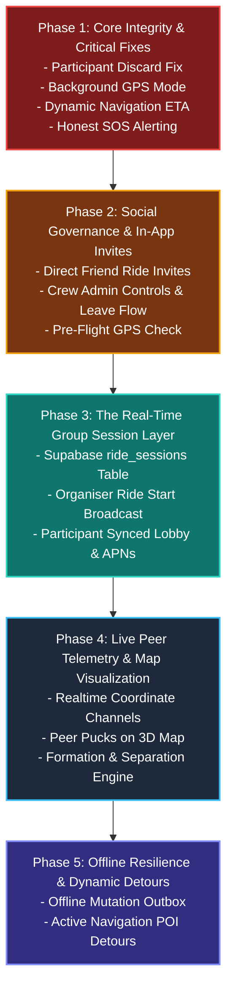

# RECOMMENDED IMPLEMENTATION SEQUENCE & ROADMAP

**Convoy iOS Application Architecture Audit**  
**Document:** `docs/product/RECOMMENDED_IMPLEMENTATION_SEQUENCE.md`  
**Platform:** Native iOS / SwiftUI / Supabase / Realtime  
**Inspection Date:** November 2026  

---

## 1. Executive Summary

This roadmap establishes a strict, dependency-ordered engineering sequence to transition Convoy from a collection of loosely coupled screens into an end-to-end, real-time motorcycle group riding application.

The sequencing is designed around three architectural rules:
1. **Safety & Core Integrity First:** Eliminate safety liabilities (fake SOS) and core calculation bugs (flat 45 km/h ETA, background location termination).
2. **Close Existing Flow Gaps:** Fix broken data handoffs (`finishPlan` discarding participants, missing in-app ride invites, crew member removal).
3. **Build the Shared Group Session Layer:** Establish the real-time session before attempting peer map visualization.

---

## 2. Dependency Graph & Phase Overview



---

## 3. Detailed Phase Breakdown

### Phase 1: Core Integrity & Critical Bug Fixes (Week 1–2)
*Goal: Make existing single-player flows honest, robust, and safe.*

#### 1.1 Fix Participant Discard in `AppState.finishPlan()`
- **Action:** Update `AppState.finishPlan()` to inspect `self.selectedCrew` and `self.selectedFriends`.
- **Backend:** Update `SupabaseManager.createRide()` to accept participant IDs. Batch-insert records into `ride_members` with `status: 'invited'`, and dispatch `ride_invite` notifications.
- **Verification:** Plan a ride with a crew; verify that all crew members see the ride in their upcoming trips.

#### 1.2 Enable Background CoreLocation Tracking
- **Action:** In `LocationService.swift`:
  ```swift
  manager.allowsBackgroundLocationUpdates = true
  manager.pausesLocationUpdatesAutomatically = false
  ```
- **Project Configuration:** Enable `UIBackgroundModes: ["location"]` in `Info.plist`.
- **Verification:** Lock the iPhone during navigation; verify turn-by-turn voice prompts continue speaking at maneuvers.

#### 1.3 Replace Flat 45 km/h ETA in `RideNavView.swift`
- **Action:** Port the `SegmentAwareRoutingCalibrator` from Stage 6A into `RideNavView`.
- **Calculation:** Compute remaining time by sampling the remaining route polylines and weighting speeds by road classification (expressway, arterial, urban) and rider moving pace.

#### 1.4 Remediate SOS Emergency Alert
- **Action:** Wire `SOSButtonView` to a real dispatch service.
- **Immediate Fix:** If backend telephony is not ready, replace the misleading "SOS BROADCAST SENT" message with a native `tel:112` or `tel:911` emergency dialer prompt and an honest SMS dispatch sheet containing current GPS coordinates.

---

### Phase 2: Social Governance & In-App Invitations (Week 3)
*Goal: Provide seamless social control over crews and trips.*

#### 2.1 Direct In-App Friend & Crew Invitations
- **Action:** Add an "Invite Friends" tab to `InviteCodeView.swift`.
- **Capabilities:** Displays friends list and crew roster with multi-select checkmarks, dispatching in-app `ride_invite` notifications without forcing riders to exit to WhatsApp.

#### 2.2 Crew Member Governance & Admin Lifecycle
- **Action:** In `CrewDetailView.swift`:
  - Add admin swipe-to-remove action for members.
  - Add "Leave Crew" action for non-admin members.
  - Add "Edit Crew" modal for updating name, motto, and avatar.
  - Add "Disband Crew" action with confirmation alert.

#### 2.3 Pre-Flight Navigation Checks
- **Action:** In `RideDetailsView.swift`, verify `CLLocationManager.authorizationStatus()` before launching `RideStartingView`. Present an explanatory permission prompt if disabled.

---

### Phase 3: The Real-Time Group Ride Session Layer (Week 4–5)
*Goal: Connect multiple riders to a single authoritative live ride session.*

#### 3.1 Database Migration: Group Sessions Table
```sql
CREATE TABLE ride_sessions (
    id UUID PRIMARY KEY DEFAULT gen_random_uuid(),
    ride_id UUID NOT NULL REFERENCES rides(id) ON DELETE CASCADE,
    leader_id UUID NOT NULL REFERENCES profiles(id),
    status TEXT NOT NULL CHECK (status IN ('lobby', 'in_progress', 'paused', 'completed')),
    started_at TIMESTAMPTZ NOT NULL DEFAULT now(),
    ended_at TIMESTAMPTZ
);
```

#### 3.2 Organizer Start Ceremony & Realtime Broadcast
- **Action:** When the organizer taps "Start ride", call `SupabaseManager.startRideSession(rideId:)`.
- **Broadcast:** Publish a `RIDE_STARTED` event over Supabase Realtime channel `ride:<id>`.
- **Participant UX:** When the broadcast is received, participant devices automatically display an animated banner: *"Ride has departed! Tap to join navigation."*

---

### Phase 4: Live Peer Telemetry & Map Visualization (Week 6–7)
*Goal: Enable riders to see each other live on the 3D map with formation spacing.*

#### 4.1 Realtime Coordinates Channel
- **Action:** During active navigation, each client transmits its coordinate every 2 seconds via Supabase Realtime Presence or ephemeral broadcast:
  ```json
  {
    "user_id": "uuid",
    "coordinate": {"lat": 12.9716, "lng": 77.5946},
    "speed_kmh": 68.4,
    "heading": 184.2,
    "battery_pct": 0.82
  }
  ```

#### 4.2 Multi-Rider Map Markers in `RideNavView.swift`
- **Action:** In the MapKit canvas:
  ```swift
  ForEach(app.groupRiders) { peer in
      Annotation(peer.displayName, coordinate: peer.coordinate) {
          PeerRiderPuck(peer: peer)
      }
  }
  ```

#### 4.3 Group Spacing & Separation Engine
- **Action:** Calculate distance from current rider to Group Leader and Sweep.
- **UI Card:** Render a compact dark glass HUD pill showing:
  - Lead: `-1.2 km` (Ahead)
  - Sweep: `+800 m` (Behind)
  - Alert: Yellow warning badge if a rider falls behind by > 3 km.

---

### Phase 5: Offline Resilience & Dynamic Detours (Week 8)
*Goal: Ensure reliability in remote mountain passes with zero connectivity.*

#### 5.1 Local Mutation Outbox (SwiftData Offline Sync)
- **Action:** Wrap all network writes (status updates, stop logging) in an outbox queue. If offline, persist mutations to SwiftData and flush automatically upon network re-establishment.

#### 5.2 Dynamic Navigation POI Detour Routing
- **Action:** When a user taps a nearby petrol station in `POIFinder`, invoke routing engine to insert the waypoint as a detour into the active polyline and update turn instructions.

---

## 4. Summary Roadmap Milestone Timeline

| Milestone | Deliverables | Estimated Duration | Dependencies |
| :--- | :--- | :--- | :--- |
| **M1: Bug Fixes & Safety** | Participant discard fix, Background GPS, Dynamic ETA, Honest SOS | 2 Weeks | None |
| **M2: Social & Invites** | In-app trip invites, Crew admin removal/leave, Pre-flight checks | 1 Week | M1 |
| **M3: Real-Time Session** | `ride_sessions` table, Organizer start broadcast, Synced lobby | 2 Weeks | M1, M2 |
| **M4: Peer Map & Spacing** | Realtime telemetry broadcast, Peer pucks, Group separation HUD | 2 Weeks | M3 |
| **M5: Offline & Detours** | SwiftData outbox queue, Dynamic POI waypoint routing | 1 Week | M4 |
| **Total Horizon** | **Production-Ready Motorcycle Group Riding System** | **8 Weeks** | — |

