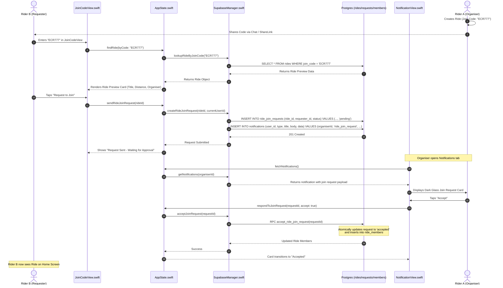

# TRIP INVITATION & JOIN BY CODE USER FLOW AUDIT

**Convoy iOS Application Architecture Audit**  
**Document:** `docs/product/TRIP_INVITATION_AND_JOIN_FLOW.md`  
**Platform:** Native iOS / SwiftUI / Supabase  
**Inspection Date:** November 2026  

---

## 1. Executive Summary & Flow Architecture

The Trip Invitation and Join system in Convoy governs how prospective participants discover, request, and gain entry to planned rides. 

The architecture operates via a **6-character alphanumeric code** system coupled with an **organizer approval gate**.

### Key Flow Components:
1. **Invite Generation:** Rides automatically generate a 6-character alphanumeric code upon creation (e.g., `ECR777`).
2. **Sharing Mechanism:** Organizers share the join code via an iOS share sheet link (`convoy.app/r/<code>`) or physical verbal/text communication.
3. **Lookup & Preview:** Prospective riders enter the code in `JoinCodeView`. The app queries Supabase and displays an interactive Ride Preview Card.
4. **Request Submission:** The rider submits a formal join request (`status: 'pending'`).
5. **Organizer Approval:** The trip organizer receives a push/in-app notification, views the requester's profile, and executes **Accept** or **Decline**.
6. **Membership Finalization:** Upon acceptance, the requester is added to the ride roster (`ride_members`).

---

## 2. End-to-End User Journey Walkthrough



---

## 3. Screen-by-Screen Deep Dive

### 3.1 Screen: Ride Details & Invite Sharing ([`RideDetailsView.swift`](file:///Users/user52/Desktop/Convoy-Main/Convoy/RideDetailsView.swift#L215-L235) & [`InviteCodeView.swift`](file:///Users/user52/Desktop/Convoy-Main/Convoy/InviteCodeView.swift#L10))

#### UI & Actions:
- On `RideDetailsView`, tapping the "Invite" action button presents `InviteCodeView` as a dark-glass bottom sheet.
- **Join Code Badge:** Displays the 6-character code in high-contrast monospace orange text (e.g., `K 9 Q 2 M 1`). Tapping the badge copies the code to the iOS system clipboard with haptic feedback (`UINotificationFeedbackGenerator().notificationOccurred(.success)`).
- **Share Link Button:** Triggers standard iOS `ShareLink(item: URL(string: "https://convoy.app/r/\(ride.joinCode)")!)`.
- **CRITICAL AUDIT FINDING — Missing Direct In-App Friends Invite:**
  - There is **no in-app user picker** in `InviteCodeView`.
  - The organizer cannot tap "Invite Friends from Convoy" or select crew members directly from this screen.
  - The entire invitation mechanism is dependent on the organizer copying the code and leaving the app to paste it into external messengers (WhatsApp, iMessage, Telegram).

---

### 3.2 Screen: Entering Join Code ([`JoinCodeView.swift`](file:///Users/user52/Desktop/Convoy-Main/Convoy/JoinViews.swift#L10-L160))

#### Access Points:
- Located on the main **Ride Hub (`HomeView.swift`)** via the top quick-action pill "Join with Code".
- Also deep-link enabled via URL scheme `convoy://join/<code>` and universal links `https://convoy.app/r/<code>`.

#### Interaction & Validation:
- Custom 6-cell character input field that auto-advances focus and capitalizes all inputs automatically.
- Sanitizes input to alphanumeric characters only (`[A-Z0-9]`).
- Once 6 characters are entered, automatically executes `app.findRide(byCode: code)`.

#### Found Ride Preview Card:
- If a ride is found:
  - Renders a floating Dark Glass card displaying:
    - Ride Title (e.g., "Dawn Patrol to Mahabalipuram")
    - Scheduled Date & Time
    - Route Distance (km) & Estimated Duration
    - Organiser Avatar, Name, and Rider Rating
    - Current Confirmed Riders Count
  - Action Button: **"Send Request to Join"**
- If already joined:
  - Button state changes to disabled: `"Already Joined This Ride"`.
- If request pending:
  - Button state displays: `"Request Pending Approval"`.
- If invalid code:
  - Displays red warning alert: `"No ride found with code '\(code)'. Please verify and try again."`

---

### 3.3 Screen: Organizer Notification & Approval Hub ([`NotificationView.swift`](file:///Users/user52/Desktop/Convoy-Main/Convoy/NotificationView.swift#L15-L210))

#### Presentation:
- Accessed via the Bell icon in the top header of `HomeView`.
- Filter tabs: **"All"** and **"Requests"**.
- Each Join Request card displays:
  - Requester's Profile Avatar and Display Name
  - Requester's Motorcycle Model (e.g., "KTM 390 Adventure")
  - Target Ride Name
  - Timestamp of request
  - Dual action pills: **"Decline"** (Muted red outline) and **"Accept"** (Solid green glass).

#### Execution & Edge Case Protection:
- Tapping **Accept**:
  - Triggers `app.respondToJoinRequest(requestId: id, accept: true)`.
  - Optimistically updates UI to "Accepted" with a green checkmark.
  - Backend executes atomic RPC `accept_ride_join_request` in Postgres, guaranteeing that:
    1. The request status is verified as `pending`.
    2. The caller is authenticated and verified as the ride organizer.
    3. The ride has not exceeded capacity or ended.
    4. The user is inserted into `ride_members` with `role = 'member'` and `status = 'accepted'`.
- Tapping **Decline**:
  - Updates request status to `declined`.
  - Card animates out of the feed.

---

## 4. Source of Truth & Database Verification

### 4.1 Schema Inventory
Defined in migration [`20261104000000_harden_ride_joins.sql`](file:///Users/user52/Desktop/Convoy-Main/supabase/migrations/20261104000000_harden_ride_joins.sql):

```sql
CREATE TABLE ride_join_requests (
    id UUID PRIMARY KEY DEFAULT gen_random_uuid(),
    ride_id UUID NOT NULL REFERENCES rides(id) ON DELETE CASCADE,
    requester_id UUID NOT NULL REFERENCES profiles(id) ON DELETE CASCADE,
    organizer_id UUID NOT NULL REFERENCES profiles(id) ON DELETE CASCADE,
    status TEXT NOT NULL CHECK (status IN ('pending', 'accepted', 'declined', 'cancelled')),
    created_at TIMESTAMPTZ NOT NULL DEFAULT now(),
    updated_at TIMESTAMPTZ NOT NULL DEFAULT now(),
    CONSTRAINT unique_pending_request UNIQUE (ride_id, requester_id)
);
```

### 4.2 Data Integrity Matrix

| Risk / Edge Case | Handled by Implementation? | Mechanism |
| :--- | :--- | :--- |
| **Duplicate Pending Requests** | **Yes** | Database Unique Constraint `unique_pending_request (ride_id, requester_id)` rejects second attempt. |
| **Joining Own Ride** | **Yes** | Client-side validation in `JoinCodeView` + Backend check rejecting `requester_id == organizer_id`. |
| **Simultaneous Double Approval** | **Yes** | Handled atomically in Postgres via `FOR UPDATE` row lock on `ride_join_requests`. |
| **Join Code Collision** | **Yes** | Retry loop with cryptographic random alphanumeric generation in `Ride.generateUniqueCode()`. |
| **Unauthenticated Approval** | **Yes** | RLS policy enforces `auth.uid() == organizer_id` on `ride_join_requests` updates. |
| **In-App Direct Invites** | **NO (MISSING)** | No friend selector exists for rides; code sharing is purely external. |

---

## 5. Summary Verdict

The Join-by-Code and Request Approval architecture is **robust, securely gated by backend verification, and provides high-fidelity feedback**.

The single most critical UX gap is the **absence of in-app direct invitations**: an organizer cannot invite a friend or a crew directly from the ride details screen without manually copying and sending a raw code via third-party messaging apps.

