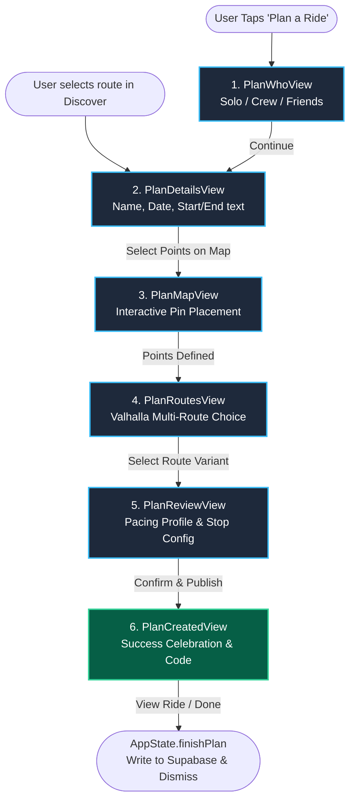

# TRIP PLANNING USER FLOW & ROUTE CREATION AUDIT

**Convoy iOS Application Architecture Audit**  
**Document:** `docs/product/TRIP_PLANNING_USER_FLOW.md`  
**Platform:** Native iOS / SwiftUI / Supabase / MapKit / Valhalla  
**Inspection Date:** November 2026  

---

## 1. Executive Summary & Flow Architecture

Trip Planning in Convoy represents the primary operational pipeline where a rider defines:
1. **Who is riding** (Solo, Crew, or Selected Friends)
2. **Trip Identity & Schedule** (Title, Start Date/Time, Rendezvous notes)
3. **Route Geography** (Origin, Destination, Waypoints, POIs)
4. **Pacing & Rest Strategy** (Pacing profile, Fuel stops, Meal breaks, Safety buffer)
5. **Final Review & Dispatch** (Summary card, Final route preview, Persist to Backend)

The planning process is structured as a multi-step full-screen modal orchestrated by `app.activePlanStep` in [`AppState.swift`](file:///Users/user52/Desktop/Convoy-Main/Convoy/AppState.swift) and presented in [`HomeView.swift:230-260`](file:///Users/user52/Desktop/Convoy-Main/Convoy/HomeView.swift#L230-L260).

---

## 2. Step-by-Step Screen Walkthrough



---

### 2.1 Step 1: `PlanWhoView.swift` — Participant Definition

- **File Reference:** [`PlanWhoView.swift:15-180`](file:///Users/user52/Desktop/Convoy-Main/Convoy/PlanWhoView.swift#L15-L180)
- **UI Elements:**
  - Segmented card selection:
    1. **"Just Me (Solo Ride)":** Sets `app.selectedCrew = nil`, `app.selectedFriends = []`.
    2. **"With a Crew":** Expands a list of the user's joined crews. Tapping one sets `app.selectedCrew = crew`.
    3. **"With Specific Friends":** Opens a multi-select search modal ([`PlanPickerView.swift`](file:///Users/user52/Desktop/Convoy-Main/Convoy/PlanPickerView.swift)) allowing the rider to select specific friends into `app.selectedFriends`.
- **Validation:** User must select at least one option. "Continue" button unlocks immediately upon valid selection.
- **Transition:** Tapping "Continue" increments `app.activePlanStep = .details`.

---

### 2.2 Step 2: `PlanDetailsView.swift` — Trip Metadata & Endpoints

- **File Reference:** [`PlanDetailsView.swift:20-220`](file:///Users/user52/Desktop/Convoy-Main/Convoy/PlanDetailsView.swift#L20-L220)
- **Origin Points / Handoff Logic:**
  - **Case A: Initiated from Home:** Route name and endpoints are empty. The user types a custom ride name (e.g., "Sunday Morning Breakfast Run").
  - **Case B: Initiated from Discover ("Plan this ride"):** The form automatically pre-populates with the Discover route name (e.g., "Bangalore to Nandi Hills"), starting point, destination, distance, and baseline duration.
- **Input Fields:**
  - Ride Name (Required text field)
  - Date & Time Picker (`DatePicker` bound to `planStartDate`)
  - Start Location Text Field
  - Destination Location Text Field
- **Transition:** Tapping "Set on Map" pushes to `PlanMapView` (`app.activePlanStep = .map`).

---

### 2.3 Step 3: `PlanMapView.swift` — Interactive Waypoint Placement

- **File Reference:** [`PlanMapView.swift:25-240`](file:///Users/user52/Desktop/Convoy-Main/Convoy/PlanMapView.swift#L25-L240)
- **UI & Capabilities:**
  - MapKit interactive canvas centered on current location (`LocationService.currentCoordinate`).
  - Search bar using `MKLocalSearchCompleter` to search addresses or landmarks.
  - Pin placement: Tapping on map sets or adjusts Start Pin (Green) and Destination Pin (Red).
  - Waypoints / Fuel Stop pins can be toggled on/off.
- **Routing Engine Trigger:** Once both start and destination coordinates are confirmed, `PlanMapView` invokes:
  ```swift
  await app.calculatePlannedRoutes(from: startCoord, to: destCoord)
  ```
  which sends coordinates to Valhalla or local routing calibrator.
- **Transition:** Navigates to `PlanRoutesView` (`app.activePlanStep = .routes`).

---

### 2.4 Step 4: `PlanRoutesView.swift` — Route Variant Selection

- **File Reference:** [`PlanRoutesView.swift:18-190`](file:///Users/user52/Desktop/Convoy-Main/Convoy/PlanRoutesView.swift#L18-L190)
- **UI & Route Variants:**
  - Interactive map displaying multi-colored route polylines:
    - **Recommended / Fastest Route:** Green polyline with distance and ETA badge.
    - **Scenic / Twisties Route:** Purple polyline highlighting winding ratio and elevation profile.
    - **Highway / Direct Route:** Blue polyline prioritizing major arterial expressways.
  - Route Summary Cards at bottom:
    - Distance (km)
    - Base Saddle Time (hrs/mins)
    - Curvature Rating (Low / Medium / High)
    - Surface condition indicator
- **Selection Action:** User selects their preferred route alternative, which sets `app.selectedPlannedRoute = route`.
- **Transition:** Tapping "Customize Pacing & Stops" proceeds to `PlanReviewView` (`app.activePlanStep = .review`).

---

### 2.5 Step 5: `PlanReviewView.swift` — Pacing, Stops & Safety Buffer

- **File Reference:** [`PlanReviewView.swift:20-210`](file:///Users/user52/Desktop/Convoy-Main/Convoy/PlanReviewView.swift#L20-L210)
- **Controls & Engine Interfacing:**
  - **Pacing Profile Segment:** `Relaxed (0.9x)` | `Balanced (1.0x)` | `Brisk (1.15x)`
  - **Stops Configurator:**
    - Fuel Stops: Stepper (0 to 5 stops, +15 mins each)
    - Rest / Chai Breaks: Stepper (0 to 5 stops, +20 mins each)
    - Meal Stops: Stepper (0 to 2 stops, +45 mins each)
  - **Dynamic Total Trip Duration Card:**
    - Recalculates dynamically: `Total Duration = Saddle Time + Stop Delays`.
- **Primary CTA:** "Confirm & Create Ride".
- **Transition:** Tapping creates the ride object and presents `PlanCreatedView` (`app.activePlanStep = .created`).

---

### 2.6 Step 6: `PlanCreatedView.swift` & `finishPlan()`

- **File Reference:** [`PlanCreatedView.swift:15-120`](file:///Users/user52/Desktop/Convoy-Main/Convoy/PlanCreatedView.swift#L15-L120)
- **Presentation:**
  - Dark glass celebration modal featuring animated checkmark.
  - Generates a unique 6-character ride join code (e.g., `X7K9PQ`).
  - QR Code display for instant physical scanning.
  - Native iOS Share Sheet trigger (`ShareLink` for `convoy.app/r/<code>`).
- **Completion Action:**
  - Tapping "View Ride Details" or "Done" executes `app.finishPlan()`.

---

## 3. The Critical Participant Disconnect Bug

### 3.1 Trace of Execution in `AppState.finishPlan()`

Inspection of lines 937–973 in [`AppState.swift`](file:///Users/user52/Desktop/Convoy-Main/Convoy/AppState.swift#L937-L973) reveals a severe architectural bug:

```swift
// AppState.swift lines 945-965
func finishPlan() async {
    guard let route = selectedPlannedRoute else { return }
    
    let joinCode = Ride.generateUniqueCode()
    let newRide = Ride(
        id: UUID().uuidString,
        title: planTitle.isEmpty ? "Weekend Ride" : planTitle,
        date: planStartDate,
        origin: route.originName,
        destination: route.destinationName,
        distanceKm: route.distanceKm,
        durationMinutes: route.totalDurationMinutes,
        ridersGoing: 1, // <--- CRITICAL BUG 1: Hardcoded to 1
        joinCode: joinCode,
        status: .planned,
        routePolyline: route.encodedPolyline,
        riders: [
            Rider(
                id: currentUser.id,
                name: currentUser.displayName,
                avatarData: currentUser.avatarData,
                role: .lead
            ) // <--- CRITICAL BUG 2: Only the creator is included!
        ]
    )
    
    // Save to Supabase
    await SupabaseManager.shared.createRide(ride: newRide)
    
    // Reset planning state
    self.selectedCrew = nil       // <--- DISCARDED WITHOUT ACTION!
    self.selectedFriends = []     // <--- DISCARDED WITHOUT ACTION!
    self.activePlanStep = nil
    self.currentRide = newRide
}
```

### 3.2 Backend Isolation in `SupabaseManager.createRide()`

Inspection of lines 580–625 in [`SupabaseManager.swift`](file:///Users/user52/Desktop/Convoy-Main/Convoy/SupabaseManager.swift#L580-L625) shows what happens in the database:

```swift
func createRide(ride: Ride) async throws -> Ride {
    // 1. Insert ride row into 'rides' table
    let insertedRide = try await client.database
        .from("rides")
        .insert(ride)
        .select()
        .single()
        .execute()
        .value
        
    // 2. Insert creator into 'ride_members' table
    let member = RideMember(
        rideId: ride.id,
        userId: currentUserId,
        role: "organiser",
        status: "accepted"
    )
    try await client.database
        .from("ride_members")
        .insert(member)
        .execute()
        
    // NOTICE: Neither crew_id nor selectedFriends user IDs are passed!
    // No invitations are generated!
    // No crew members are notified or added to ride_members!
    return insertedRide
}
```

### 3.3 Product Impact Summary

| Intended User Mental Model | Actual Code Implementation | User Experience Consequence |
| :--- | :--- | :--- |
| "I am planning a ride for my crew 'Bangalore Bullets'. All 12 crew members will be invited and see it on their ride calendar." | `selectedCrew` is reset to `nil`. No crew members are added to `ride_members`. | The ride is created strictly as a Solo ride with 1 participant. Crew members never receive an invite, notification, or calendar entry. |
| "I selected my 3 friends Alex, Priya, and Dave in PlanWhoView." | `selectedFriends` is discarded at line 962. | None of the 3 friends are added to the ride. The user must manually text them the 6-character code outside the app. |
| The planning wizard presents a full multi-step experience for selecting participants. | `PlanWhoView` acts as a purely cosmetic UI screen. | Severe drop-off in user trust when participants realize selecting a crew did nothing. |

---

## 4. Summary Verdict & Technical Remediation Plan

The Trip Planning wizard is visually complete, responsive, and features high-fidelity routing and pacing controls. However, **the participant pipeline is completely broken at the persistence layer**.

### Required Architecture Fix:
1. **Extend `Ride` Model and Supabase `rides` Table:**
   Add `crew_id: UUID?` as an optional foreign key on `rides`.
2. **Batch Member Insertion in `createRide()`:**
   - If `selectedCrew != nil`: Automatically insert all active crew members into `ride_members` with `status: 'invited'`, and dispatch `ride_invite` notifications.
   - If `selectedFriends.isEmpty == false`: Insert all selected friend user IDs into `ride_members` with `status: 'invited'`.
3. **Synchronize Initial `ridersGoing`:**
   Set `ridersGoing` to `1 + pendingInvitesCount` or maintain accurate count of confirmed versus invited participants.

