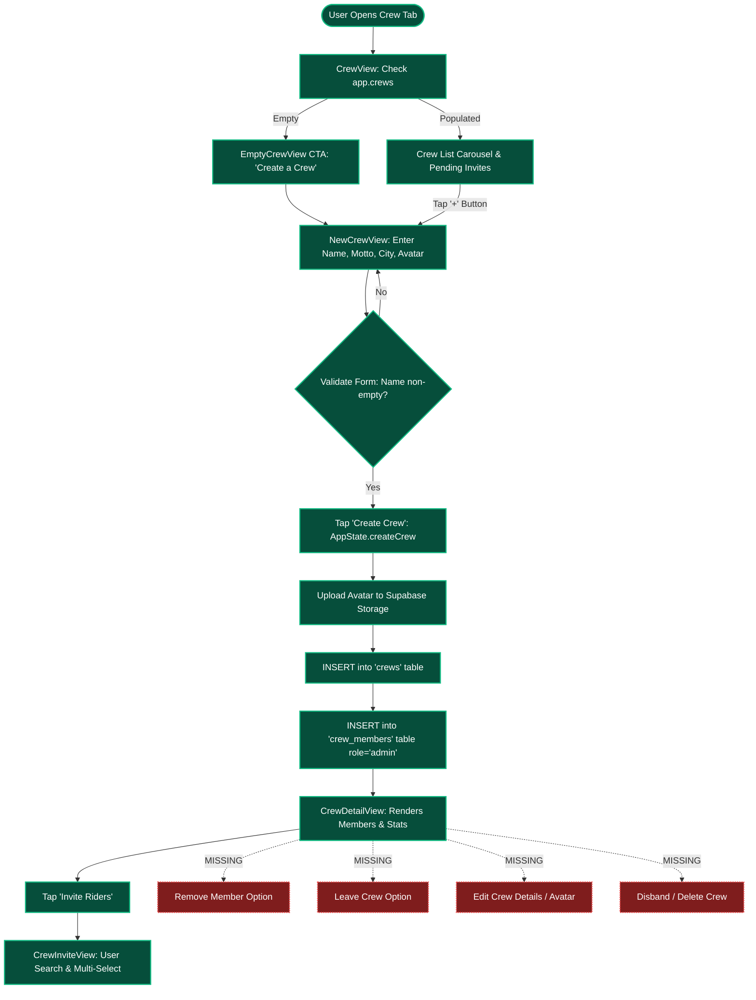
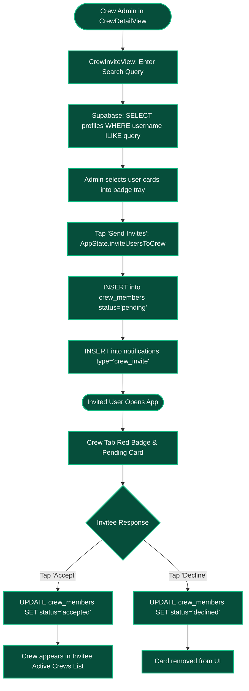
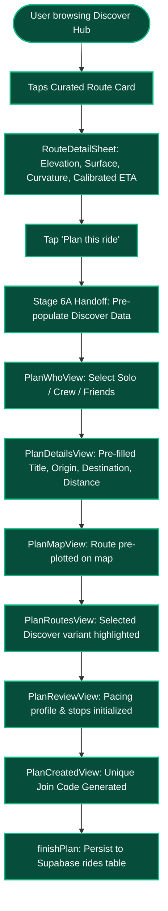
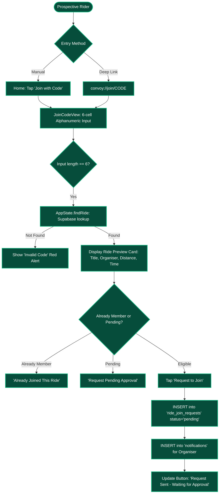
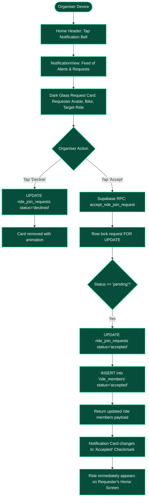
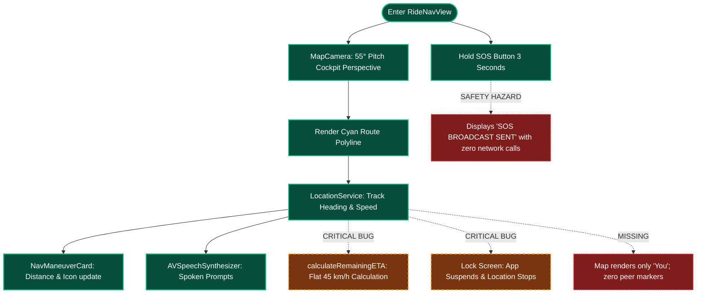

# CONVOY USER FLOW ARCHITECTURE & DIAGRAMS

**Convoy iOS Application Architecture Audit**  
**Document:** `docs/product/USER_FLOW_DIAGRAMS.md`  
**Platform:** Native iOS / SwiftUI / Supabase  
**Inspection Date:** November 2026  

---

## 1. Visual Legend & Status Taxonomy

All diagrams in this document employ a standardized color and border taxonomy to reflect actual code implementation status:

- <span style="color:#10b981;font-weight:bold;">Green / Solid Border:</span> **Fully Implemented & Production-Connected**
- <span style="color:#f59e0b;font-weight:bold;">Orange / Dashed Border:</span> **Partially Implemented / Contains Bugs or Gaps**
- <span style="color:#ef4444;font-weight:bold;">Red / Dotted Border:</span> **Completely Missing / Mocked / Non-Functional**

---

## 2. Diagram 1: Crew Creation & Management Journey



---

## 3. Diagram 2: Crew Member Invitation & Acceptance Journey



---

## 4. Diagram 3: Trip Planning Journey (From Scratch / Home Hub)

```mermaid
flowchart TD
    Home([Home Hub: Tap 'Plan a Ride']) --> Step1[PlanWhoView: Select Participant Mode]
    Step1 -->|Select 'Just Me'| WhoDone[app.selectedCrew = nil]
    Step1 -->|Select 'With a Crew'| WhoCrew[app.selectedCrew = crew]
    Step1 -->|Select 'With Friends'| WhoFriends[app.selectedFriends = [friends]]
    
    WhoDone --> Step2[PlanDetailsView: Empty inputs]
    WhoCrew --> Step2
    WhoFriends --> Step2
    
    Step2 --> EnterDetails[User enters Ride Name, Date, Start/End addresses]
    EnterDetails --> Step3[PlanMapView: Confirm Coordinates on MapKit Canvas]
    Step3 --> Step4[PlanRoutesView: Calibrate Multi-Route Alternatives]
    Step4 --> Step5[PlanReviewView: Pacing Profile & Stop Configurator]
    Step5 --> Step6[PlanCreatedView: Displays 6-char Code & QR]
    
    Step6 --> TapDone[Tap 'Done' / 'View Ride': finishPlan]
    TapDone --> InsertRide[INSERT into 'rides' table]
    InsertRide --> InsertCreator[INSERT creator into 'ride_members' status='accepted']
    
    InsertCreator -.->|CRITICAL BUG: Discarded!| DropCrew[selectedCrew & selectedFriends DISCARDED]
    InsertCreator -.->|CRITICAL BUG: Discarded!| NoInvites[Zero Invites Dispatched to Selected Crew/Friends]

    classDef done fill:#064e3b,stroke:#10b981,stroke-width:2px,color:#fff;
    classDef partial fill:#78350f,stroke:#f59e0b,stroke-width:2px,stroke-dasharray: 5 5,color:#fff;
    classDef missing fill:#7f1d1d,stroke:#ef4444,stroke-width:2px,stroke-dasharray: 2 2,color:#fff;

    class Home,Step1,WhoDone,WhoCrew,WhoFriends,Step2,EnterDetails,Step3,Step4,Step5,Step6,TapDone,InsertRide,InsertCreator done;
    class DropCrew,NoInvites missing;
```

---

## 5. Diagram 4: Trip Planning Journey (From Discover Route Handoff)



---

## 6. Diagram 5: Join-by-Code & Preview Journey



---

## 7. Diagram 6: Organizer Request Approval Journey



---

## 8. Diagram 7: Ride Start & Participant Synchronization

```mermaid
flowchart TD
    subgraph Current Implementation [CURRENT IMPLEMENTATION - ISOLATED]
        A1[Organiser taps 'Start ride'] --> B1[RideStartingView: 3s Local Countdown]
        B1 --> C1[AppState.isNavigating = true]
        C1 --> D1[RideNavView: Local MapKit turn-by-turn]
        
        P1[Participant on their phone] --> P2[RideDetailsView: Button still says 'Start ride']
        P2 --> P3[Zero Alerts / Zero Sync / Unaware of Organiser Departure]
    end

    subgraph Required Implementation [REQUIRED SPECIFICATION - SYNCHRONIZED]
        A2[Organiser taps 'Start ride'] --> B2[Location Authorization Pre-flight Check]
        B2 --> C2[Supabase Mutation: UPDATE rides SET status='in_progress']
        C2 --> D2[Broadcast over Supabase Realtime Channel 'ride_session:id']
        D2 --> E2[Participant Devices receive 'RIDE_STARTED' event]
        E2 --> F2[Participant Device auto-presents 'Ride Started' Action Sheet]
        F2 --> G2[Participant taps 'Join Navigation']
        D2 --> H2[Both Devices connect to Shared Realtime Telemetry Channel]
    end

    classDef done fill:#064e3b,stroke:#10b981,stroke-width:2px,color:#fff;
    classDef missing fill:#7f1d1d,stroke:#ef4444,stroke-width:2px,stroke-dasharray: 2 2,color:#fff;

    class A1,B1,C1,D1 done;
    class P1,P2,P3,A2,B2,C2,D2,E2,F2,G2,H2 missing;
```



---

## 9. Diagram 8: Active Navigation & Telemetry Journey



---

## 10. Diagram 9: End-to-End System Journey

```mermaid
flowchart LR
    CrewPhase[1. Crew Formation<br/>Create Club & Add Members] --> PlanPhase[2. Trip Planning<br/>Pick Route, Pacing, Stops]
    PlanPhase --> InvitePhase[3. Join & Invitation<br/>Share 6-char Code & Approve Requests]
    InvitePhase --> StartPhase[4. Ride Day Start<br/>Countdown & Session Initialization]
    StartPhase --> NavPhase[5. Active Group Riding<br/>3D Navigation, Spacing, Telemetry]
    NavPhase --> PostPhase[6. Ride Completion<br/>Stats, Roster Summary, Archive]

    classDef done fill:#064e3b,stroke:#10b981,stroke-width:2px,color:#fff;
    classDef partial fill:#78350f,stroke:#f59e0b,stroke-width:2px,stroke-dasharray: 5 5,color:#fff;
    classDef missing fill:#7f1d1d,stroke:#ef4444,stroke-width:2px,stroke-dasharray: 2 2,color:#fff;

    class CrewPhase,InvitePhase done;
    class PlanPhase,StartPhase,NavPhase,PostPhase partial;
```



